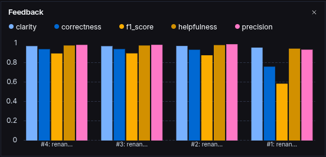
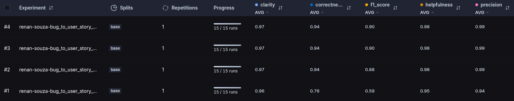
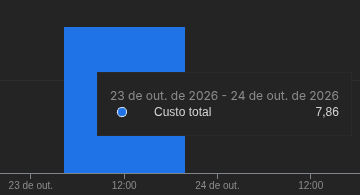

# Pull, Otimização e Avaliação de Prompts com LangChain e LangSmith

Projeto do desafio do MBA em IA. O objetivo é pegar um prompt de baixa qualidade no LangSmith Prompt Hub, otimizá-lo com técnicas de Prompt Engineering, publicar a nova versão e avaliá-la até que todas as métricas fiquem acima de 0.8.

O prompt converte relatos de bugs em user stories com critérios de aceitação.

O enunciado original do desafio está em `README_old.md`.

## Técnicas Aplicadas (Fase 2)

### Few-shot Learning

**O que é:** colocar no prompt exemplos de entrada e saída para o modelo seguir o mesmo padrão.

**Por que escolhi:** é obrigatória no desafio, mas também é a técnica que mais ajuda neste caso. As user stories de referência do dataset seguem um formato bem específico (nomes de seções, formato Dado/Quando/Então, tamanho de cada parte). Descrever isso só com instruções não é suficiente. Com exemplos, o modelo copia a estrutura.

**Como apliquei:** o prompt tem 3 exemplos, um para cada nível de complexidade do dataset:

- Simples: filtro por data que não retorna pedidos.
- Médio: importação de CSV que falha com nomes acentuados, com passos para reproduzir e log de erro.
- Complexo: sistema de agendamento com três problemas no mesmo relato (agendamento duplicado, fuso horário errado no SMS e lentidão na agenda).

Os exemplos foram criados do zero, com domínios diferentes dos usados no dataset, para não dar ao modelo as respostas da avaliação.

Os exemplos não inventam fatos: números, prazos e causas vêm só do próprio relato. Isso foi feito de propósito: o modelo imita os exemplos, então se eles inventassem números ou prazos, o modelo aprenderia a inventar também. A métrica de Precision penaliza isso.

Mas os exemplos mostram deduções que um PM faria, mesmo sem estarem escritas no relato. No exemplo simples, por exemplo, o relato só diz que o filtro não retorna nada, e os critérios incluem:

- pedidos do primeiro e do último dia do período devem aparecer (erro comum em filtros de data);
- se não houver pedidos no período, o usuário deve ver uma mensagem.

Assim o modelo aprende a diferença entre inventar um fato e completar o requisito.

### Role Prompting

**O que é:** definir uma persona para o modelo, com o papel e as responsabilidades dela.

**Por que escolhi:** a tarefa é escrever user stories, que é trabalho de Product Manager. Definir a persona ajuda o modelo a usar o vocabulário certo e a focar no impacto para o usuário, e não só no defeito técnico.

**Como apliquei:**

```
Você é um Product Manager experiente, com forte background em análise de negócios.
Seu trabalho é transformar relatos de bugs em user stories claras, com foco no impacto
para o usuário e em critérios de aceitação testáveis.
```

Em vez de só dizer o cargo, a persona descreve o que essa pessoa faz e o que entrega. O "background em análise de negócios" traz o foco em critérios de aceitação e regras de negócio, que é o trabalho de um Business Analyst.

### Skeleton of Thought

**O que é:** dar ao modelo uma estrutura de resposta definida antes que ele escreva o conteúdo.

**Por que escolhi:** o dataset tem 3 níveis de complexidade e cada nível tem uma estrutura de resposta diferente. Um bug simples tem só a user story e um bloco de critérios. Um bug complexo tem vários blocos, critérios técnicos, contexto e tasks. Sem isso, o modelo tende a responder tudo no mesmo tamanho: ou escreve pouco nos bugs complexos (perde F1-Score), ou escreve demais nos simples (perde Clarity e Precision).

**Como apliquei:** o prompt define critérios objetivos para cada nível e mostra o esqueleto de cada um nos exemplos:

```
## Níveis de complexidade
- Simples: relato curto, um único problema, sem detalhes técnicos.
- Médio: um único problema com logs, passos para reproduzir ou detalhes técnicos.
- Complexo: o relato descreve vários problemas distintos.
```

### Regras explícitas

Não é uma das técnicas da lista do desafio, mas é um requisito do prompt. A seção de regras foi escrita pensando nas métricas:

- "Não invente fatos" e "Não proponha features novas": para a métrica de Precision, que penaliza alucinação.
- "Deduza os requisitos implícitos que um PM experiente colocaria": para o F1-Score. A regra lista onde procurar: a regra de negócio que o bug viola, quando o dado deve refletir a mudança, a mensagem ao usuário em caso de erro e em que momento do fluxo validar.
- "Em bugs de interface, inclua Critérios de Acessibilidade": para o F1-Score, já que as referências de bugs de tela cobram navegação por teclado (foco, ESC, fechar ao clicar fora).
- "Escreva os critérios de aceitação como regras gerais": para o modelo não colocar os valores do relato (ex.: "mostra 50, mas existem 42") no "Então". Esses valores vão para o contexto.
- "Preserve os dados técnicos": para o F1-Score, já que as referências do dataset repetem os detalhes técnicos do relato (endpoint, erro, causa).
- "Não gere texto além do necessário": para a métrica de Clarity, que avalia concisão.
- "Responda somente com a user story, sem rótulos ou introdução": para a saída não começar com "Aqui está a user story:" ou "User story:", que não existem nas referências.

O prompt também tem uma seção de casos especiais: se o relato for vago, o modelo lista o que falta em "Pontos a confirmar" em vez de inventar; se tiver dados sensíveis (senhas, tokens, e-mails), não os repete na saída.

### Como cheguei nas regras finais

A primeira versão das regras era rígida: "Não invente dados, o relato do bug já contém o que precisa ser resolvido". A Precision ficou alta, mas o F1-Score de alguns exemplos ficou abaixo de 0.8. O pior foi 0.75, e o reasoning do avaliador explicava o motivo: faltavam requisitos que não estavam no relato, mas que um PM colocaria (no bug do dashboard, "atualizar em tempo real" e "contar só usuários com status ativo"), e os critérios repetiam os números do relato em vez de regras gerais.

A correção foi separar "inventar fatos" (proibido) de "deduzir requisitos implícitos" (esperado), e pedir critérios como regras gerais. Depois disso, só um exemplo ficou abaixo de 0.8 (0.77): o bug do modal atrás do menu lateral, em que faltaram critérios de acessibilidade. Adicionei a regra de acessibilidade só para bugs de interface, para não aparecer acessibilidade em bugs de backend. Por último, coloquei no exemplo simples a dedução sobre o primeiro e o último dia do período. Na avaliação final, todos os exemplos ficaram com F1 de 0.84 ou mais.

## Resultados Finais

### Link público do dataset de avaliação

https://smith.langchain.com/public/bd60215c-7ce6-4b36-b295-a78e9261cc23/d

### Notas da versão final

| Métrica | v1 | v2 |
|---|---|---|
| Helpfulness | 0.95 | 0.98 |
| Correctness | 0.76 | 0.94 |
| F1-Score | 0.59 | 0.90 |
| Clarity | 0.96 | 0.97 |
| Precision | 0.94 | 0.99 |

```
==================================================
AVALIAÇÃO DE PROMPTS OTIMIZADOS
==================================================

Provider: google
Modelo Principal: gemini-2.5-flash
Modelo de Avaliação: gemini-3.8-flash

Criando dataset de avaliação: mba-ia-pull-evaluation-prompt-eval...
   ✓ Carregados 15 exemplos do arquivo datasets/bug_to_user_story.jsonl
   ✓ Dataset 'mba-ia-pull-evaluation-prompt-eval' já existe, usando existente
   ✓ https://smith.langchain.com/o/6b7eb784-e84b-4115-abc7-f0d9253c3c63/datasets/b243c3f3-26bf-45bf-9273-b7e600e4d7d9

======================================================================
PROMPTS PARA AVALIAR
======================================================================

Este script irá puxar prompts do LangSmith Hub.
Certifique-se de ter feito push dos prompts antes de avaliar:
  python src/push_prompts.py


🔍 Avaliando: renan-souza/bug_to_user_story_v2
   Puxando prompt do LangSmith Hub: renan-souza/bug_to_user_story_v2
   ✓ Prompt carregado com sucesso
   Rodando experimento no LangSmith...
View the evaluation results for experiment: 'renan-souza-bug_to_user_story_v2-eaf11e42' at:
https://smith.langchain.com/o/6b7eb784-e84b-4115-abc7-f0d9253c3c63/datasets/b243c3f3-26bf-45bf-9273-b7e600e4d7d9/compare?selectedSessions=418d5b3d-bb70-46f7-b77b-03b1fe66c496


[1] F1:0.85 Clarity:0.95 Precision:0.98
[2] F1:0.91 Clarity:0.90 Precision:1.00
[3] F1:0.94 Clarity:0.98 Precision:1.00
[4] F1:0.91 Clarity:0.98 Precision:1.00
[5] F1:0.87 Clarity:0.98 Precision:0.98
[6] F1:0.88 Clarity:0.98 Precision:1.00
[7] F1:0.94 Clarity:0.98 Precision:1.00
[8] F1:0.84 Clarity:0.98 Precision:0.97
[9] F1:0.90 Clarity:0.95 Precision:0.97
[10] F1:0.84 Clarity:0.98 Precision:0.98
[11] F1:0.85 Clarity:0.98 Precision:0.97
[12] F1:0.97 Clarity:1.00 Precision:1.00
[13] F1:0.92 Clarity:0.98 Precision:0.97
[14] F1:0.95 Clarity:1.00 Precision:1.00
[15] F1:0.90 Clarity:0.98 Precision:0.97

==================================================
Prompt: renan-souza/bug_to_user_story_v2
==================================================

Métricas Derivadas:
  - Helpfulness: 0.98 ✓
  - Correctness: 0.94 ✓

Métricas Base:
  - F1-Score: 0.90 ✓
  - Clarity: 0.97 ✓
  - Precision: 0.99 ✓

--------------------------------------------------
📊 MÉDIA GERAL: 0.9556
--------------------------------------------------

✅ STATUS: APROVADO - Todas as métricas >= 0.8

==================================================
RESUMO FINAL
==================================================

Prompts avaliados: 1
Aprovados: 1
Reprovados: 0

Resultados no LangSmith (notas gravadas como feedback no experimento):
  renan-souza/bug_to_user_story_v2
    https://smith.langchain.com/o/6b7eb784-e84b-4115-abc7-f0d9253c3c63/datasets/b243c3f3-26bf-45bf-9273-b7e600e4d7d9/compare?selectedSessions=418d5b3d-bb70-46f7-b77b-03b1fe66c496

✅ Todos os prompts atingiram todas as métricas >= 0.8!
```





### Comparação entre v1 e v2

| | v1 | v2 |
|---|---|---|
| Persona | "assistente que ajuda a transformar relatos de bugs em tarefas para desenvolvedores" | Product Manager com background em análise de negócios |
| Instruções | Uma frase: "crie uma user story a partir dele" | Objetivo, regras e critérios de complexidade |
| Formato de saída | Não definido | Formato "Como um..., eu quero..., para que..." e critérios em Dado/Quando/Então |
| Exemplos | Nenhum | 3 exemplos, um por nível de complexidade |
| Relato do bug | Enviado duas vezes (no system prompt e no user prompt) | Enviado só no user prompt |
| Final do prompt | "User Story gerada:", resto do estilo de prompt de completion | Removido |

O que mudou e por quê:

- **O relato do bug aparecia duas vezes na v1.** A variável `{bug_report}` estava no system prompt e no user prompt. Na v2 o system prompt tem só as instruções e o relato vai só no user prompt, que é a separação correta entre os dois.
- **A v1 pedia "tarefas para desenvolvedores".** Isso é diferente de user story. A v2 deixa claro que a saída é do ponto de vista do usuário.
- **A v1 não dizia qual formato usar.** Cada resposta saía de um jeito, longe das referências do dataset. A v2 define o formato e mostra exemplos.
- **A v1 não diferenciava bugs simples de complexos.** A v2 adapta o tamanho da resposta ao relato.

## Como Executar

### Pré-requisitos

- Python 3.10 ou superior
- Conta no LangSmith, com API key e um handle público no Hub
- API key do Google Gemini (gratuita) ou da OpenAI

### Instalação

```
python3 -m venv venv
source venv/bin/activate
pip install -r requirements.txt
```

### Configuração

Copie o arquivo de exemplo e preencha as variáveis:

```
cp .env.example .env
```

| Variável | Descrição |
|---|---|
| `LANGSMITH_API_KEY` | API key do LangSmith |
| `USERNAME_LANGSMITH_HUB` | Seu handle público no LangSmith Hub |
| `LLM_PROVIDER` | `google` ou `openai` |
| `GOOGLE_API_KEY` ou `OPENAI_API_KEY` | Chave do provider escolhido |
| `LLM_MODEL` | Modelo que gera as user stories |
| `EVAL_MODEL` | Modelo que avalia as respostas |

Neste projeto foi usado `LLM_PROVIDER=google` com `gemini-2.5-flash` para gerar e `gemini-3.8-flash` para avaliar. Veja o motivo na seção "Escolha do modelo".

### Execução

1. Fazer pull do prompt original (salva em `prompts/bug_to_user_story_v1.yml`):

```
python src/pull_prompts.py
```

2. Fazer push do prompt otimizado (lê `prompts/bug_to_user_story_v2.yml` e publica no Hub como público):

```
python src/push_prompts.py
```

3. Rodar a avaliação:

```
python src/evaluate.py
```

4. Rodar os testes de validação do prompt:

```
pytest tests/test_prompts.py
```

## Escolha do modelo

Foram usados dois modelos, com papéis diferentes:

- `LLM_MODEL=gemini-2.5-flash` gera as user stories.
- `EVAL_MODEL=gemini-3.8-flash` avalia as respostas.

Para escolher, avaliei o prompt de partida (o v2 era igual ao v1 nas três rodadas) em três combinações:

| Geração | Avaliação | Média geral | Status |
|---|---|---|---|
| `gemini-3.8-flash` | `gemini-3.8-flash` | 0.9660 | Aprovado |
| `gemini-2.5-flash` | `gemini-2.5-flash` | 0.8757 | Reprovado (F1 0.69) |
| `gemini-2.5-flash` | `gemini-3.8-flash` | 0.8379 | Reprovado (F1 0.59 e Correctness 0.76) |

Escolhi a última combinação por ser a mais justa:

- Quando o mesmo modelo gera e avalia, o avaliador tende a favorecer textos no estilo que ele mesmo produz. Foi o que aconteceu com o 3.8 nas duas funções: o prompt sem nenhuma otimização foi aprovado com 0.9660, o que mostra que a avaliação não separava um prompt fraco de um bom.
- Separar quem gera de quem avalia dá um avaliador independente e a nota mais baixa das três. Assim a baseline reprova de verdade e deixa espaço para mostrar a melhora do v2.
- O `gemini-2.5-flash` aceita `temperature=0` na geração, o que deixa o resultado mais reproduzível.

Todas as comparações entre v1 e v2 foram feitas com essa mesma combinação.

Foi utilizado a versão paga do `gemini`, o custo foi menos de R$8,00, contando junto o teste entre modelos de LLM.
